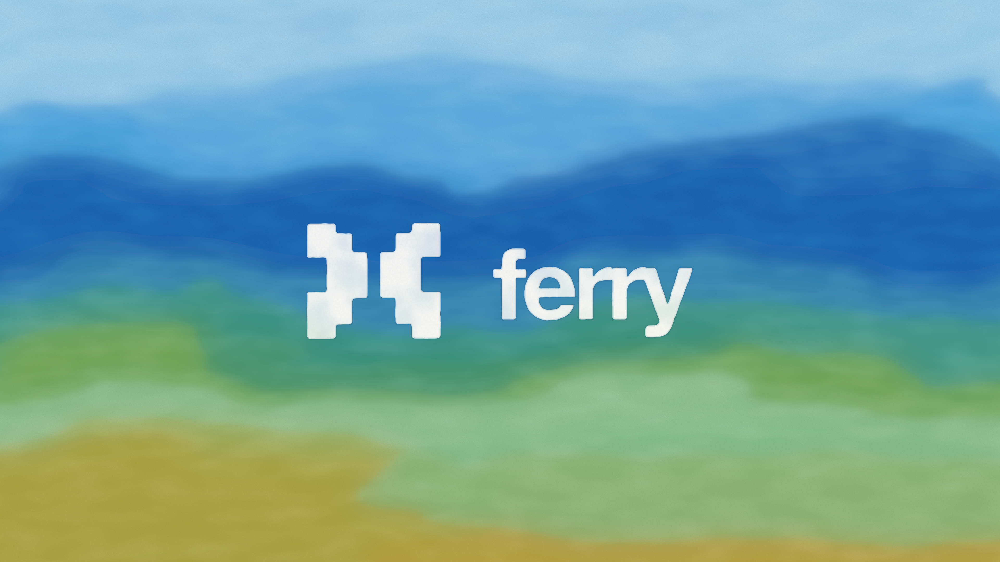

# Ferry

The icon and wordmark for Ferry, a cross-chain payments protocol. They're the first step of a brand made with AI around the Paint engine. Only the logo is done so far.



## The mark

Two blocky facing halves: two shores meeting, with the crossing between them. Its stepped outline also reads as a butterfly, which crosses continents on almost no effort. Ferry moves value between chains the same way: steady, and nothing lost on the way. See `BRIEF.md` for the brand it belongs to.

## The wordmark

Ferry Sans Bold in lowercase, the brand's own typeface (see `type/`). It's set against the mark with the same construction as the devx labs lockup, measured from Figma. A is the height of the d (ascender to baseline):

- The mark is 1.63A tall.
- It sits 0.35A above the ascender and 0.28A below the baseline.
- It stands 0.74A from the first letter.

Ferry Sans is tuned to the proportions of the first, approved version (drawn in Helvetica Neue), and each letter sits on the same centre as in that version. Width, height and the gap to the mark match it within 0.1%, and the ink within 0.7%. The double r nearly meets and the r touches the y, so the bleed runs them together.

Ferry Sans softens every outer corner with half the butterfly's corner radius, so the letters and wings look cut from the same material.

Over that sits a light watercolour bleed:

- Edges wander a little.
- The fill dries unevenly.
- Pigment pools at the rim.
- The tightest pairs run together: the double r at the arms, and the r into the y.

On the wash, the white reads as paper left bare. At 32 px and below, use the clean SVGs, because the bleed turns to mush at those sizes.

## Files

| File | What |
|---|---|
| `export/ferry-hero-4k.png` | 3840 × 2160, lockup on the wash |
| `export/ferry-lockup-ink.png`, `-white.png` | 4000 × 1280, transparent, with bleed |
| `export/ferry-mark-ink.png`, `-white.png` | 2000 × 1760, transparent, with bleed |
| `export/ferry-appicon-1024.png` | App icon on the wash |
| `export/ferry-lockup-clean.svg`, `ferry-mark-clean.svg` | Vectors without bleed, for small sizes |
| `export/ferry-sheet.png` | Overview: on paper, reversed, close-ups, icon sizes |
| `src/bleed.html` | The live sheet. The bleed is an SVG filter, `bleed()` |
| `src/butterfly.html` | The clean study: construction guides, corner detail, weight check |
| `src/export.html` | Renders one asset per URL, e.g. `export.html?a=lockup&c=white` |
| `src/butterfly-mark.svg` | The mark as drawn in Figma |
| `tools/wordmark.py` | Rebuilds `src/glyphs.js` from Ferry Sans, each letter on the approved centres |
| `type/` | Ferry Sans: fonts, specimen, licence (`type/README-FerrySans.txt`) |
| `tools/typeface.py` | Rebuilds Ferry Sans from TeX Gyre Heros |
| `LOGO_DESIGN.md` | The rules every decision was checked against |
| `system/SYSTEM.md`, `system/system.html` | Core system: the palette with roles and contrast, grid and spacing, formats, use cases |

To re-export, open `src/export.html` with a query string in headless Chrome, for example:

```bash
"/Applications/Google Chrome.app/Contents/MacOS/Google Chrome" --headless=new --default-background-color=00000000 --force-device-scale-factor=2 --window-size=2000,640 --screenshot=lockup.png "file://$PWD/src/export.html?a=lockup&c=ink&w=92"
```

`a` can be `lockup`, `mark`, `hero` or `appicon`, and `c` can be `ink` or `white`.

The wordmark is built from Ferry Sans, a renamed and modified TeX Gyre Heros under the GUST Font License (LPPL 1.3c). Ferry owns the logo outright; no font licence is needed to use or ship it.
